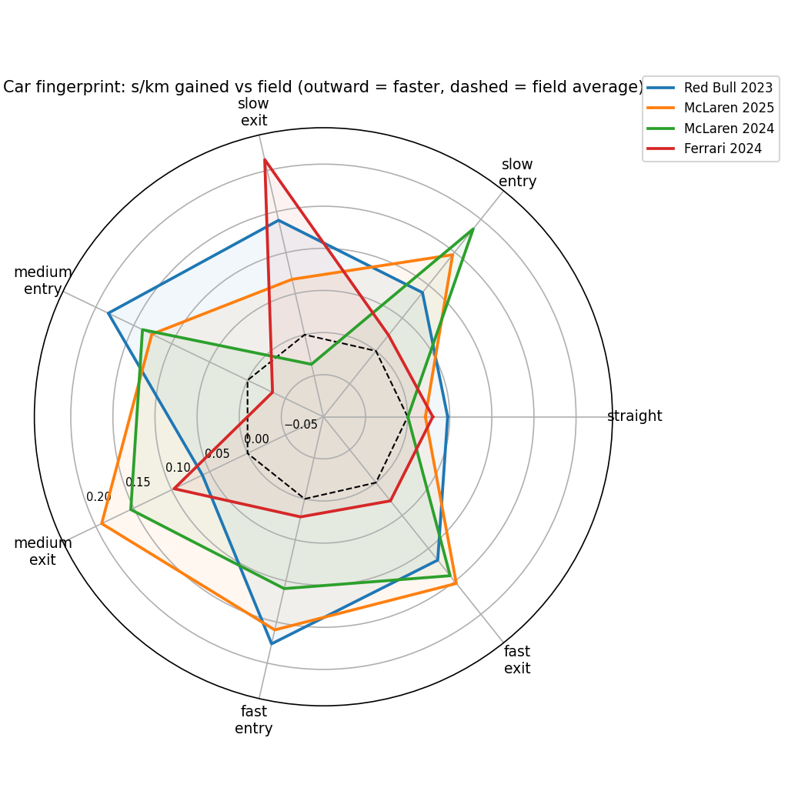

# Car vs Driver Performance Decomposition from F1 Telemetry

Break each car's qualifying advantage into **where on the lap it comes from**
(straights, slow/medium/fast corner entry = braking, corner exit = traction), then
separate **car** from **driver** using teammates and drivers who change teams.

> Questions it answers: *Why was the car fast at Monza but slow in Hungary?
> Is this driver's edge in braking or traction? How much of a gap is car, how much driver?*

## Results on real data (OpenF1 qualifying, 2023 to 2025)

68 qualifying sessions, 26 drivers, 30 team-seasons. Every number below is read from `results/`; nothing is tuned by hand.



**1. The car matters more than the driver.** Spread (standard deviation) of the team-season effect is **0.28 s**,
versus **0.08 s** for drivers measured against their teammates. A team-season's effect includes the average
quality of its two drivers, so this is the usual "teammate benchmark" definition, not a pure car measurement.

**2. The rankings pass a sanity check.** Fastest team-seasons (seconds lost vs that event's Q3 field, negative =
faster): Red Bull 2023 (-0.39), McLaren 2025 (-0.33), McLaren 2024 (-0.28), Ferrari 2024 (-0.22), Red Bull 2024 (-0.22).
Slowest: Williams 2023 (+0.77), Alpine 2025 (+0.60), Williams 2024 (+0.50), Aston Martin 2024 (+0.48).
Compare teams **within a season only**: every number is relative to that event's top-10 field, which changes between years.

**3. Driver gaps look plausible, with a caveat.** Largest gaps to teammates: Verstappen (-0.19 s) and Russell (-0.19 s)
faster; Sargeant (+0.15), Hamilton (+0.13) and Perez (+0.12) slower. Drivers with few Q3 appearances
(see `n_events` in `driver_total_effect.csv`) are noisy and should not be read into.

**4. Fingerprints (radar, outward = faster).** Straight-line axes barely separate the top cars. Ferrari 2024 has the
largest spike at slow-corner exit, McLaren 2025 at medium-speed corner exit, and Red Bull 2023 at medium and fast
entry. These are descriptive patterns from approximate segment definitions, not confirmed car characteristics.

**5. A negative result: the layout predictor does not work convincingly.** Predicting a team-season's pace at an
unseen track from its fingerprint beat a layout-blind baseline in only **37 of 68** events (54%, consistent with
chance). Rank correlation 0.705 vs 0.666 and mean error 0.261 s vs 0.267 s are a negligible edge. Overall team-season
pace dominates, and corner-type mix adds little on top of it with Q3-only fields (about 6.6 teams per event) and
3.7 Hz telemetry.

**Honest limits of these results.** No confidence intervals yet (a bootstrap over events is the obvious next step).
The field is each event's Q3 participants, so teams that only sometimes reach Q3 appear at their best. Telemetry is
3.7 Hz. Qualifying pace is not race pace.

## Status

| Part | Status |
|---|---|
| Segmentation, decomposition, models, prediction, plots | Built; tested on synthetic telemetry with planted effects, and run on real 2023-25 data |
| OpenF1 download (default) | Works on live data; tested offline against a fake OpenF1 server |
| FastF1 download (`--source fastf1`) | Kept but currently blocked for everyone: since ~15 Oct 2026 F1's timing archive rejects anonymous requests (FastF1 issue #978) |

Synthetic validation (planted effects): car recovered at r = 1.00, driver at r = 0.99. A regression test covers the
case where teammate pairs never change teams, which broke an earlier version of the model on real data.

## Quick start (Windows: use `py -m`; macOS/Linux: `python3 -m`)

```bash
py -m pip install -r requirements.txt
py -m f1cvd demo                                   # synthetic sanity check -> results/demo/
py tests/test_pipeline.py ; py tests/test_openf1.py

py -m f1cvd fetch --year 2024 --events Monza       # ONE weekend first, ~30 s
py -m f1cvd fetch --year 2023                     # then 2024, then 2025: ~12 min per season (run one year at a time)
py -m f1cvd analyse                                # decompose + fit + predict + plots -> results/
```

OpenF1 allows 30 requests/min on the free tier (~13 requests per weekend). The client throttles itself and
caches every response in `data/cache/openf1/`, so interrupted or repeated runs cost nothing. 2023 is the earliest
season available. OpenF1 is for personal / research / non-commercial use; a link back to openf1.org is appreciated.

## Method

1. **Fetch** (`openf1.py`). Each driver's best **Q3** lap, found by matching their official Q3 time to the lap with
   that exact duration (falls back to Q2 if Q3 is thin). Speed arrives at ~3.7 Hz; distance is its integral, rescaled
   so every lap has the same length. Lap `date_start` is only approximate in the API, so each lap window is nudged
   by up to 1 s to match the field's median speed-vs-distance trace. Elapsed time is pinned to the official lap time.
2. **Segment** (`segments.py`). On the fastest lap: apexes = prominent speed minima. *Entry* = braking point to
   apex, *exit* = apex until half the speed gain is recovered, the rest = *straight*. Corners are classed slow
   (<120 km/h), medium, fast (>200 km/h).
3. **Decompose** (`decompose.py`). Per segment, time minus field mean. Segments partition the lap, so deltas sum
   **exactly** to the lap delta (tested). Converted to s/km so different layouts are comparable.
4. **Separate car from driver** (`model.py`). Teammate split (model-free) plus a crossed random-effects model
   `y = team + driver + noise`. Team levels are **unshrunk** (`--team-mode fixed`, default), so a driver effect
   means *gap to teammates* (and to drivers they swapped with), and the team effect is the team-season's overall
   level **including the average quality of its two drivers**. Driver effects are shrunk (ridge, penalty chosen by
   event-grouped cross-validation). The older `ridge` mode shrinks both and splits a pair's shared level arbitrarily
   when pairs rarely change teams: on real 2023-25 data it made cars look smaller than drivers (0.08 s vs 0.20 s),
   and a synthetic regression test reproduces that failure.
   **A team is re-estimated every season** (`--team-scope season`, default), because a car changes year to year;
   drivers keep one identity across seasons. Drivers moving between team-seasons are what link them.
5. **Predict** (`predict.py`). Leave-one-event-out: a team-season's fingerprint x km of each segment type at the
   unseen track, vs a layout-blind baseline. Reports Spearman rank and MAE.

## Outputs (`results/`)

`team_fingerprint.csv`, `driver_fingerprint.csv`, `team_total_effect.csv`, `driver_total_effect.csv`,
`teammate_split.csv`, `layout_prediction.csv`, `team_radar.png`, `driver_heatmap.png`, `delta_trace.png`.

## Limitations to state in your write-up

- **Resolution.** 3.7 Hz is about one sample per 20 m at racing speed. Corner apexes and brake points are coarser
  than in FastF1-grade data; expect noisier driver effects, especially in short corners.
- **Identifiability.** If two teammates never change teams, shared driver quality is indistinguishable from the car.
  Use several seasons (2023 to latest) so drivers move between team-seasons.
- **2026 regulation reset.** Cars changed fundamentally; because teams are season-specific this is handled, but the
  2026 season has fewer events so far.
- **Qualifying is not racing.** Engine modes, low fuel and one-lap tyre prep differ from race trim.
- **Q3 selection.** Only top-10 qualifiers are compared; a team missing Q3 drops out of that event.
- **Lap quality.** Fastest laps include track evolution, wind and mistakes. Per-event noise is real.
- **Segmentation.** Flat-out sweeps with no speed minimum merge into straights. Thresholds are tunable.
- **"Exit = traction" is an interpretation.** Check it against throttle traces (available in OpenF1 `car_data`)
  before claiming it.
- Team lineage mapping (`TEAM_ALIASES` in `data.py`, e.g. Kick Sauber/Audi → one lineage) is a judgement call.

## Ideas to extend

- Use throttle/brake/gear channels: braking-point distance, throttle-application time.
- Swap the ridge for `statsmodels.MixedLM` and compare variance estimates.
- Add tyre compound and track temperature (OpenF1 `stints`, `weather`) as covariates.
- A race-pace version using the same decomposition on race stints.

## Layout

```
f1cvd/  openf1.py fetch.py(fastf1) data.py segments.py decompose.py model.py predict.py plots.py synthetic.py pipeline.py cli.py
tests/  test_pipeline.py  test_openf1.py
results/demo/  example outputs from the synthetic run
```

## Data and licence

Telemetry comes from the community OpenF1 API (https://openf1.org), used here for personal and research purposes.
This project is not affiliated with Formula 1 or OpenF1. Code is released under the MIT licence (see `LICENSE`).
